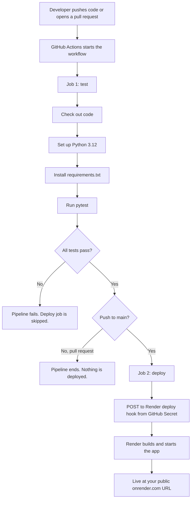

# Simple CI/CD Pipeline using GitHub Actions

A small Flask web app with a complete CI/CD pipeline. Every push to `main` is installed, tested with Pytest, and deployed to Render automatically, but only if every test passes.


> Replace `YOUR-USERNAME` in the badge URL with your GitHub username after you create the repository.

## Project overview

The app is a dashboard that explains its own pipeline. It shows the current version, the deployment environment, the Git commit it was built from, and its uptime. It exposes a health check (`/health`) and a JSON status API (`/api/status`).

## Problem statement

Deploying by hand is slow and error-prone. Someone can forget to run the tests, or ship broken code. This project removes those risks: a failing test blocks the release, and a passing build is deployed with no manual steps.

## Objectives

1. Trigger the pipeline on every push to `main` and on pull requests targeting `main`.
2. Install dependencies and run automated Pytest tests.
3. Stop the pipeline if any test fails.
4. Deploy to Render only after tests pass, and only on pushes to `main`.
5. Keep all secrets in GitHub Secrets, never in the code.

## Technology stack

| Tool | Purpose |
| --- | --- |
| Python 3.12 | Language |
| Flask | Web framework |
| Gunicorn | Production server on Render |
| Pytest | Automated tests |
| Git and GitHub | Version control and hosting |
| GitHub Actions (YAML) | CI/CD automation |
| Render (free tier) | Hosting |

## CI/CD architecture



## Workflow explanation

The workflow file is `.github/workflows/ci-cd.yml`.

- **Triggers:** `push` to `main` and `pull_request` targeting `main`.
- **`test` job:** checks out the code, sets up Python 3.12 (with pip caching), installs `requirements.txt`, and runs `python -m pytest -v`. If any test fails, the job fails.
- **`deploy` job:** has `needs: test`, so it waits for the tests. It also has `if: github.event_name == 'push' && github.ref == 'refs/heads/main'`, so pull requests never deploy. It sends a POST request to the Render deploy hook, which is read from the secret `RENDER_DEPLOY_HOOK_URL`.
- **Security:** the workflow has read-only permissions (`contents: read`). The secret is passed through an environment variable and is never printed. GitHub also masks secret values in logs.
- **Concurrency:** a newer push to the same branch cancels an older run that is still going.

`render.yaml` sets `autoDeploy: false`. This is important. If Render auto-deployed on every push, it would skip the tests. With auto-deploy off, the only thing that can trigger a deployment is the deploy hook, and only the `deploy` job calls it.

## Folder structure

```
simple-cicd-pipeline/
├── app.py                      Flask application
├── requirements.txt            Python dependencies
├── Procfile                    Start command (gunicorn)
├── render.yaml                 Render Blueprint (optional)
├── pytest.ini                  Pytest settings
├── README.md
├── .gitignore
├── .env.example
├── templates/
│   ├── index.html              Dashboard page
│   └── 404.html                Not-found page
├── static/
│   ├── css/style.css
│   └── js/script.js
├── tests/
│   ├── __init__.py
│   └── test_app.py             8 Pytest tests
├── docs/screenshots/           Put your screenshots here
└── .github/workflows/ci-cd.yml
```

## Local installation (Windows PowerShell)

Install [Python 3.12](https://www.python.org/downloads/) (tick "Add python.exe to PATH") and [Git for Windows](https://git-scm.com/download/win) first. Then open PowerShell in the project folder:

```powershell
cd path\to\simple-cicd-pipeline

# 1. Create the virtual environment
python -m venv .venv

# 2. Activate it
.\.venv\Scripts\Activate.ps1

# 3. Install dependencies
python -m pip install --upgrade pip
pip install -r requirements.txt
```

If PowerShell blocks activation with an execution policy error, run this once, then activate again:

```powershell
Set-ExecutionPolicy -Scope CurrentUser -ExecutionPolicy RemoteSigned
```

## Run the application

```powershell
python app.py
```

Open <http://localhost:5000>. Also try <http://localhost:5000/health> and <http://localhost:5000/api/status>. Press `Ctrl+C` to stop.

> Gunicorn (used on Render) does not run on Windows. That is fine. Locally you use `python app.py`, and Render uses gunicorn on Linux.

## Run the tests

```powershell
python -m pytest -v
```

You should see `8 passed`.

## Create a GitHub repository and push the code

1. Sign in at <https://github.com> and click **New repository**.
2. Name it `simple-cicd-pipeline`. Keep it **Public** (easier to show in an evaluation). Do **not** add a README, .gitignore or license, because the project already has them. Click **Create repository**.
3. In PowerShell, in the project folder:

```powershell
git init
git branch -M main
git add .
git commit -m "Initial commit: Flask app with CI/CD pipeline"
git remote add origin https://github.com/YOUR-USERNAME/simple-cicd-pipeline.git
git push -u origin main
```

If Git asks who you are, run these once and commit again:

```powershell
git config --global user.name "Your Name"
git config --global user.email "you@example.com"
```

The first push will start the workflow. The tests will pass, but the deploy job will fail until you finish the Render and secret setup below. That is expected.

## Deploy on Render

1. Sign up at <https://render.com> (you can use your GitHub account). No credit card is needed for the free tier.
2. Click **New +** and choose **Web Service**.
3. Connect your GitHub account and select the `simple-cicd-pipeline` repository.
4. Use these settings:

| Setting | Value |
| --- | --- |
| Name | `simple-cicd-pipeline` |
| Language / Runtime | Python 3 |
| Branch | `main` |
| Build Command | `pip install -r requirements.txt` |
| Start Command | `gunicorn app:app --bind 0.0.0.0:$PORT` |
| Instance Type | Free |

5. Under **Advanced**, set **Auto-Deploy** to **No** (so only the pipeline can deploy). Optionally set **Health Check Path** to `/health`. Add an environment variable `PYTHON_VERSION` = `3.12.3`.
6. Click **Create Web Service**. The first build takes a few minutes. When it finishes, your public URL (`https://simple-cicd-pipeline-xxxx.onrender.com`) appears at the top of the page.

The app listens on the port Render provides: gunicorn binds to `$PORT`, which Render sets automatically.

> Alternative: if you use the included `render.yaml`, choose **New + > Blueprint** and select your repository. It creates the same service with auto-deploy off.

## Configure the GitHub secret

### Get the deploy hook URL

In Render, open your service, then **Settings**, scroll to **Deploy Hook**, and copy the URL. Treat it like a password: anyone with it can trigger a deploy.

### Save it in GitHub

1. Open your repository on GitHub.
2. Click **Settings > Secrets and variables > Actions**.
3. Click **New repository secret**.
4. Name: `RENDER_DEPLOY_HOOK_URL` (exactly this, case-sensitive).
5. Secret: paste the deploy hook URL.
6. Click **Add secret**.

Never put the URL in your code, README, screenshots, or videos.

## Verify the workflow in GitHub Actions

1. Open your repository and click the **Actions** tab.
2. Click the latest run of **CI/CD Pipeline**.
3. You will see two jobs: **Install and test** and **Deploy to Render**.
4. To re-run after adding the secret: open the run and click **Re-run all jobs**, or push a new commit.

How to read a run:

| What you see | Meaning |
| --- | --- |
| Green check on both jobs | Tests passed and the deploy was triggered |
| Red cross on **Install and test**, **Deploy to Render** skipped (grey) | A test failed. Nothing was deployed. This is the safety gate working |
| Green test job, red deploy job with "Secret ... is not set" | The `RENDER_DEPLOY_HOOK_URL` secret is missing or misspelled |
| Green test job, no deploy job | The run was a pull request, which never deploys |

## Verify the deployment

1. In Render, open your service and check **Events** or **Logs**. You should see a new deploy that says it was triggered by a deploy hook.
2. Open your Render URL. The dashboard should load and show `Running on Render`.
3. Open `https://YOUR-APP.onrender.com/health`. Expected: `{"status":"healthy"}`.
4. Open `https://YOUR-APP.onrender.com/api/status`. Expected: JSON with `"environment": "Render"` and the version.

## Prove the pipeline blocks bad code

1. Open `tests/test_app.py` and change `assert response.status_code == 200` in `test_home_page_returns_200` to `== 201`.
2. Commit and push:

```powershell
git add .
git commit -m "Break a test on purpose"
git push
```

3. In **Actions**, the test job turns red and the deploy job is skipped.
4. Change it back to `200`, then commit and push. The pipeline goes green and deploys.

## Render free tier limitations

- The service **spins down after about 15 minutes without traffic**. The next visit takes roughly 30 to 60 seconds to wake it. Open the URL before a demo.
- Uptime on the dashboard resets after each spin-down or deploy.
- There is a limited number of free instance hours per month, and free services have limited CPU and memory.
- Free instances have no persistent disk, so files written at runtime are lost on restart.
- Free-tier terms can change, so check Render's current pricing page.

## Screenshots

Add your own screenshots to `docs/screenshots/` and keep the links below.

| Screenshot | File |
| --- | --- |
| Dashboard on Render | `docs/screenshots/dashboard.png` |
| Passing workflow run | `docs/screenshots/actions-success.png` |
| Failed workflow with skipped deploy | `docs/screenshots/actions-failure.png` |

```markdown


```

## Troubleshooting

| Problem | Fix |
| --- | --- |
| `python` is not recognised | Reinstall Python and tick "Add python.exe to PATH", then reopen PowerShell |
| `Activate.ps1` cannot be loaded | Run the `Set-ExecutionPolicy` command shown above |
| `git push` asks for a password | Sign in through the browser window Git opens, or use a GitHub personal access token |
| Render build fails | Check the build logs. Make sure `requirements.txt` is in the repository root |
| Deploy hook returns an error | Copy the hook URL again from Render and re-save the secret |
| Site shows "Application failed to respond" | Check the Start Command is exactly `gunicorn app:app --bind 0.0.0.0:$PORT` |

## Future enhancements

- Add a linter (Flake8 or Ruff) and a code formatter check to the test job.
- Test on several Python versions with a build matrix.
- Add test coverage reporting.
- Build and publish a Docker image.
- Add a post-deploy smoke test that calls `/health` on the live URL.
- Add a staging environment that deploys from pull requests.
- Send Slack or email notifications when a deployment succeeds or fails.
